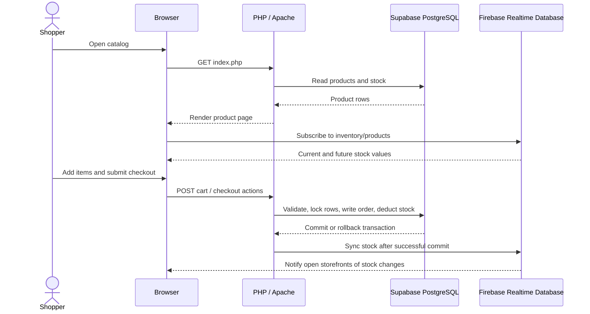

# ShopFlow E-commerce

ShopFlow is a server-rendered PHP storefront. PHP handles requests and sessions, Supabase PostgreSQL stores business data, and Firebase Realtime Database broadcasts stock changes to shoppers with the catalog open.

## A Request Through the App

When a shopper opens `index.php`, PHP reads products from PostgreSQL and renders the initial page. The browser can then filter the rendered catalog by product name and description. Category labels such as Shoes and Bags are inferred from those same text fields in PHP; there is no category table.

The main request and inventory flow is:

Registration stores a password hash in `users`. Login verifies that hash and places the user ID and role in a PHP session. Shared helpers in `includes/auth.php` check those roles, escape HTML, and validate CSRF tokens on state-changing forms. Admin pages require the `admin` role; customer actions require a signed-in non-admin account.

## Cart and Checkout Flow

Each customer has a persistent cart in PostgreSQL. Adding an item checks current stock and updates `cart_items`; changing or removing a quantity changes the cart, but does not reserve or deduct inventory. This keeps the product stock value available as the shared source of truth rather than treating each cart as a reservation.

Coupon codes are checked against their active dates, order minimum, overall usage limit, and per-customer redemption history. The browser can request an early check through `verify_coupon.php`, but checkout validates the coupon again because cart contents and coupon usage can change before the order is submitted.

Checkout is the point where an order becomes authoritative. `checkout.php` starts a PostgreSQL transaction, locks the customer's cart and product rows, validates quantities and stock, calculates the final total, and creates the order. For every item it calls `public.deduct_inventory(BIGINT, INTEGER)`, saves an order-item snapshot, updates coupon usage if needed, and clears the cart. A failed PostgreSQL step rolls back the transaction. After a successful commit, PHP attempts the Firebase inventory sync; a Firebase error is logged but cannot undo the committed order. Card and cash-on-delivery choices are demonstrations only: no payment is collected and no card details are stored.

## How the Data Fits Together

PostgreSQL is the source of truth for accounts, carts, orders, coupons, and inventory. The code expects these tables:

| Tables | Stored information |
| --- | --- |
| `users` | Names, email addresses, password hashes, and account roles |
| `products` | Catalog descriptions, prices, image references, and stock counts |
| `carts`, `cart_items` | A customer's active cart and its product quantities |
| `orders`, `order_items` | Order totals and purchase-time product, price, and quantity details |
| `coupons`, `coupon_redemptions` | Discount rules, usage counts, and which customers redeemed them |

Conceptually, a user owns a cart and orders; cart items and order items connect those records to products. A coupon can be associated with orders and redemptions. Product category is calculated from product text rather than represented by a database relationship.

The database schema itself is hosted in Supabase and is not defined in this repository. The application also depends on the PostgreSQL function `public.deduct_inventory`, whose SQL definition is external. This repository contains no schema migrations or trigger definitions, so it does not show how tables, constraints, triggers, or that function were originally created.

## Project Requirement Coverage

| Requirement | How the project addresses it | Coverage in this repository |
| --- | --- | --- |
| Registration and login | PHP registration/login pages hash passwords and create role-based sessions. | Implemented |
| Browse, cart, and checkout | The catalog reads PostgreSQL products; cart pages persist quantities; checkout creates orders and deducts stock. | Implemented |
| PHP backend for authentication and transactions | PHP page handlers use PDO for database access; coupon verification also returns JSON. | Implemented |
| Firebase real-time inventory | The browser subscribes to Realtime Database; PHP seeds and synchronizes stock from PostgreSQL. | Implemented; requires Firebase rules and Render credentials |
| Order history | `orders.php` reads a customer's orders and item snapshots. | Implemented |
| Dynamic coupon verification | Coupons are checked against dates, limits, customer redemptions, and cart totals, then rechecked during checkout. | Implemented |
| Relational database design | Queries use users, products, carts, cart items, orders, order items, coupons, and redemptions. | Used by the app; schema DDL is external |
| Categories entity | Shoes/Bags/Other labels are derived from product names and descriptions. | Partial: no `categories` table is used by this code |
| ACID checkout and inventory locking | Checkout uses a PostgreSQL transaction and row locks, then calls `public.deduct_inventory`. | Implemented by the PHP flow; stored-function definition is external |
| Database triggers or stored procedures | The checkout calls the `deduct_inventory` database function. | Not verifiable here: function SQL and trigger definitions are not included |

## Why Inventory Uses Two Databases

PostgreSQL controls whether a purchase can happen. Its row locks and `deduct_inventory` function prevent checkout from selling more units than are available. Firebase is a read-optimized mirror used to make other open storefronts react immediately; it never approves a checkout.

Inventory records live at `inventory/products/{productId}` in Firebase and contain the product ID, name, stock count, and update timestamp. On a storefront request, the PHP Admin SDK seeds that path from PostgreSQL if it is empty. When an admin adds, edits, or deletes a product, or checkout commits a stock deduction, PHP synchronizes the affected Firebase records. `JS/firebase-inventory.js` subscribes to `inventory/products` and updates the visible stock count, quantity limit, and in-stock/out-of-stock state in the browser.

The Firebase rules in `firebase-database.rules.json` allow shoppers to read inventory but deny browser writes. The PHP server writes through the Admin SDK using a service account held in Render environment settings. This is why the Firebase private key must never be placed in browser JavaScript or committed to the repository.

## Code Map

| File or directory | Role in the request flow |
| --- | --- |
| `index.php` | Loads the catalog, renders stock states, and supplies the public Firebase database URL to the browser |
| `auth/` | Creates accounts, verifies logins, and ends sessions |
| `cart.php`, `cart_add.php`, `cart_update.php` | Reads and changes persistent customer carts |
| `verify_coupon.php`, `checkout.php`, `orders.php` | Checks discounts, places orders, and displays purchase history |
| `admin/products.php` | Creates, edits, and deletes catalog products |
| `DB/database.php` | Opens the PDO PostgreSQL connection using environment settings |
| `includes/auth.php` | Provides session, role, escaping, and CSRF helpers |
| `includes/firebase-inventory.php` | Initializes the Admin SDK, seeds inventory, and syncs server-side changes |
| `JS/firebase-inventory.js` | Listens for live Firebase inventory changes and updates the catalog DOM |
| `includes/product-image.php` | Chooses image assets and derives display categories from product text |

## Runtime Configuration

The Docker image runs Apache with PHP 8.3. Composer installs the Firebase Admin SDK; the image enables PDO PostgreSQL and the PHP extensions required by the SDK. Render's web-service definition is in `render.yaml`.

The database connection reads `DB_HOST`, `DB_PORT`, `DB_NAME`, `DB_USER`, `DB_PASSWORD`, and `DB_SSLMODE`. Firebase uses `FIREBASE_DATABASE_URL` and `FIREBASE_SERVICE_ACCOUNT_JSON`. These values are supplied to the app at runtime, not hard-coded into PHP. Local placeholders are listed in `.env.example`; `.gitignore` excludes local `.env` files and Composer's `vendor/` directory.
